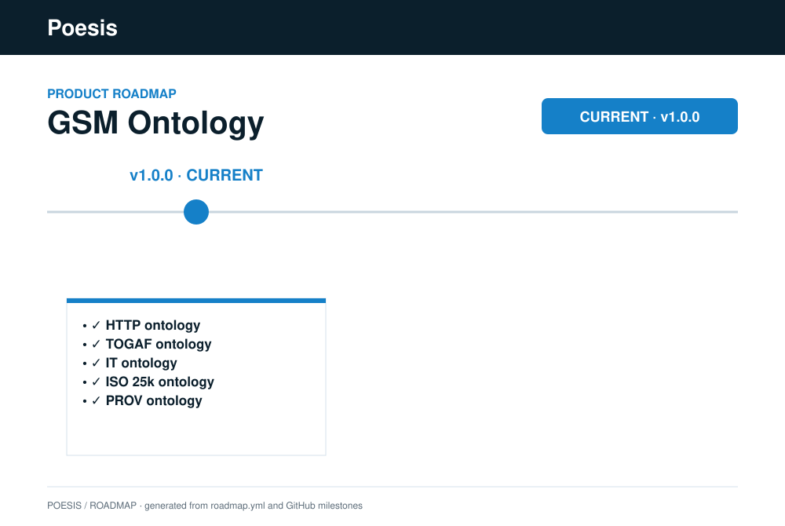

# GSM Ontology

[](https://github.com/poesis-cloud/gsm-ontology/releases/latest)
[](LICENSE)

Ontology definitions built on the **Generative System Model (GSM)**, registered as governed
ascriptions in the SIE Definition Manager (DM), and assembled into organization-specific
ontology stacks by consuming domain applications such as the Organizational Intelligence Platform (OIP).

This repository is the sourced-framework product of GSM. The normative model it is
expressed against lives in [`gsm-specifications`](https://github.com/poesis-cloud/gsm-specifications).
Non-normative research lives in [`gsm-research-lab`](https://github.com/poesis-cloud/gsm-research-lab).
All three are aggregated under the [`gsm`](https://github.com/poesis-cloud/gsm) umbrella.

> This repository is in a design-time phase. It contains ontology model statements and
> supporting sources, not runnable application code.

## Terminology and file conventions

### Ontology

A ontology is a named and versioned set of governed model elements. Its elements are
registered individually in DM. OIP groups them as a ontology and manages catalog
import, organization selection, composition, installation, and synchronization.

### Ontology ascription statement

Every governed model element of a ontology is an **ascription statement**: the JSON
content persisted as an Ascription statement in DM.

This includes all eight GSM subject types:

- Archetype
- Structure
- Mechanism
- Effector
- Receptor
- Interaction
- Directive
- Norm

Files use an explicit subject-type suffix:

| Convention | Meaning |
| --- | --- |
| `<Name>.archetype.json` | Archetype ascription statement (a JSON Schema document) |
| `<Name>.structure.json` | Structure ascription statement |
| `<Name>.mechanism.json` | Mechanism ascription statement |
| `<Name>.effector.json` | Effector ascription statement |
| `<Name>.receptor.json` | Receptor ascription statement |
| `<Name>.interaction.json` | Interaction ascription statement |
| `<Name>.directive.json` | Directive ascription statement |
| `<Name>.norm.json` | Norm ascription statement |
| `<name>.rule.star` | Supporting Mechanism rule source; not registered independently |
| `ontology-package.json` | Portable ontology aggregate descriptor; not a DM ascription |
| `README.md` | Documentation; not a ontology element |

Examples under the convention:

```text
Request.archetype.json
RequestEffector.archetype.json
RequestInteraction.archetype.json
ProcessingPrinciple.archetype.json
GdprProcessingPrinciples.directive.json
GdprAccountability.norm.json
ItDirectiveNormOperationalization.mechanism.json
directive-norm-operationalization.rule.star
```

An Archetype statement is named `.archetype.json`, rather than `.schema.json`, because
its role here is a governed Archetype ascription. Its statement content remains JSON
Schema.

For non-Archetype statements, the filename identifies the statement and GSM subject
type. Statements carry only their GSM governance grammar; everything the catalogue
knows *about* a statement (membership, provenance) lives in the ontology package.
This keeps three distinct concepts separate:

- statement identity: `ProcessingPrinciples`
- GSM subject type: `Directive` (from the filename suffix, typed by the GSM base)
- catalogue metadata: the descriptor's `elements[]` entry (`source`, etc.)

PascalCase is used for governed statement filenames. Kebab-case is used for supporting
source files and directories.

Every non-Archetype governed statement filename is **prepended with its ontology's
name** in PascalCase (`gdpr` → `Gdpr`, `iso25000` → `Iso25000`, `it` → `It`): the
`gdpr` ontology's accountability norm is `GdprAccountability.norm.json`. This keeps
non-Archetype filenames collision-free across ontologies, since those statements
carry no `$id` of their own.

Archetype statements are **exempt from the prefix**. An Archetype's namespace is its
`$id` path (`gsmarc://{authority}/{ontology}/{folder path}/{title}/v{version}`), not
its `title`: `title` is only the local name inside that namespace, validated for
internal coherence (filename stem = `title` = final `$id` segment, enforced by
`scripts/lint_layers.py` rule L5) but no longer required to be globally unique or
ontology-prefixed — the `http` ontology's request archetype is simply
`Request.archetype.json`. The `$id` path itself is not free-standing either: it MUST
mirror the file's actual folder location (`{ontology}/{subfolders}/{title}/v{n}`,
also rule L5) — an Archetype cannot claim a namespace it does not physically live in.
This follows the Definition Manager's archetype identity
model (see `sie-definition-manager/def/study/identity-model-study.md`): titles were
originally the DM's effective global primary key, which forced the ontology-prefix
workaround; the target model anchors identity on the namespaced, versioned `$id`
instead, demoting `title` to a human-readable local name. One residual caveat: Norm
`applicability` CEL expressions still resolve root identifiers by bare `title` today
(the DM has not yet migrated to `ref("$id")` — a separate, not-yet-implemented work
package in that study), so two Archetypes sharing a title after prefix removal would
be ambiguous *only if* both were ever used as CEL applicability roots in the same
governance scope; no such collision exists in the catalogue today.

### Facet composition: the mount rule and statement closure

JSON Schema namespaces *schemas* (`$id`) but **not instance properties**: `allOf`
merges facet constraints over one flat property namespace. Two facets defining the
same property name conflate data — or produce an unsatisfiable intersection when the
types diverge (real case: `availabilityTarget` is a string enum in
`ServiceReliability` and a number in `DataAvailability`). The
catalogue therefore defines its own instance-level namespacing:

- **Facet mount rule** — a composite archetype mounts each facet under an *optional*
  property whose key is the **lowerCamelCase of the facet's title**
  (`serviceReliability`, `attribution`, `platformIdentifier`). Since `title` is no
  longer ontology-prefixed, collision-freedom is no longer structural — the
  composing author is responsible for picking a distinct mount key per composite when
  two facets happen to share a short title (lint rule L7 checks sibling `allOf`
  facets, not mount-keyed properties, so this specific case is not yet
  machine-checked); optional-by-construction — the facet's
  internal `required` members apply only when the mount is present. CEL reads
  unambiguously: `ApplicationService.serviceReliability.availabilityTarget`.
  Bare `allOf` remains legal only for a single *open* facet intrinsic to the subject's
  identity (exemplar: `PhysicalTechnologyComponent` composing `PlatformIdentifier`).
- **Statement closure belongs to the DM** — archetype statements MUST NOT declare
  top-level `additionalProperties: false` / `unevaluatedProperties: false` (lint rule
  L6). The DM applies `unevaluatedProperties: false` at the root of the *resolved*
  typing archetype at ascription time (GSM §5 "Statement closure" — the same decision
  that removed author-side closure from the GSM base schemas). Author-side top-level
  closure is redundant at best and breaks facet composition at worst. Nested closures
  (inside array items, sub-objects) are unaffected and remain legitimate.

This convention is fully applied across `ontologies/`.

## Ontology membership and catalogue metadata

Statements do **not** declare their ontology. Membership is declared exactly once, by
placement: the ontology package's `elements[]` list is the package manifest, and at
runtime the consuming platform's catalogue persistence records member → DM identifier
mappings. The descriptor entry also carries the statement's catalogue metadata —
provenance (`source`), governance links (`operationalizes`), deployment guidance
(`deploymentNotes`):

```json
{
  "path": "principles/GdprProcessingPrinciples.directive.json",
  "source": {
    "authority": "European Parliament and Council of the European Union",
    "regulation": "Regulation (EU) 2016/679 (GDPR)",
    "article": "Article 5",
    "text": "Personal data shall be: (a) processed lawfully, ..."
  }
}
```

Membership means:

> This ascription statement is authored, governed, versioned, and distributed as an
> element of the ontology whose descriptor lists it.

It does not mean that the ontology is selected in a particular organization's stack.
Imported statements retain their original ontology membership (the catalogue record)
when selected by an organization ontology.

### Archetype statements

Archetype statements are governed JSON Schema documents. Their identity is the `$id`
under the ontology's `gsmarc://` namespace path; their membership is their descriptor
entry, like every other statement:

```json
{
  "$schema": "gsmarc://gsm/Archetype/v1",
  "$id": "gsmarc://gsm-ontology/gdpr/principles/ProcessingPrinciple/v1",
  "title": "ProcessingPrinciple"
}
```

### Other ascription statements

Non-Archetype statements carry **only** their GSM governance grammar and are typed
directly by the corresponding GSM base (or by a ontology Archetype where one exists,
e.g. a rootless facet composition at the domain layer). The GSM bases stay closed:
no catalogue concern is ever added to a statement payload. Authorship is not a
catalogue concern either: it is the PROV Attribution relation with OIDC-identified
agents, borne by the `prov` and `oidc` reference ontologies and composed at the domain
or organization layer (see *Authorship and trust model*).

> **DM verification pending**: the design assumes DM accepts non-Archetype statements
> typed directly by a GSM base. Previously statements were typed via wrapper Archetypes
> solely to carry the now-removed membership property.

## Layered ontology design

The ontology architecture is a strict rank-ordered stack. GSM is the upper ontology;
three ontology layers build on it, from most general to organization-specific:

```text
GSM Archetype statements            (upper ontology — vendor-neutral)
            ↑
Reference ontologies                (isolated; one external authority each)
            ↑
Domain ontologies                   (integrate reference ontologies for a domain, e.g. IT)
            ↑
Organization ontologies             (tenant-authored at runtime; never in this repository)
```

**Rank rule (machine-checked)**: a ontology may reference only GSM,
itself, and ontologies of strictly lower layer rank. In particular, reference ontologies
are **isolated** — they reference only GSM and themselves. Composition across reference
ontologies is the exclusive role of domain ontologies and happens through GSM governance
(Directives and Norms qualifying subjects across ontologies) plus declared articulation,
never through schema-level `$ref` between reference folders. The rule is enforced by
`scripts/lint_layers.py`.

Only Archetype statements participate in schema inheritance and composition. Directive,
Norm, Structure, Mechanism, and other statements are instances typed by those
Archetypes.

This stratification mirrors established ontology-engineering practice (upper ontology →
reference ontologies → domain ontologies → application ontologies, as proven at scale by
the OBO Foundry federation), while remaining generative rather than descriptive.

### Upper layer — GSM Archetype statements

GSM defines the eight structural bases: Archetype, Structure, Mechanism, Effector,
Receptor, Interaction, Directive, and Norm.

These statements define what GSM ascriptions structurally are. GSM remains
vendor-neutral and carries no catalogue-specific ontology, authorship, deployment, or
organization-stack semantics.

`gsm/Archetype` is sealed. The other seven GSM bases are extensible.

### Layer 2 — Reference ontology ascription statements

A **reference ontology** translates exactly one external authority — a standard,
protocol, regulation, or body of knowledge — into GSM-compatible ascription statements.
Current examples: TOGAF, ISO 25000, GDPR, NIS2, SCAP, and HTTP.

Reference ontologies are **isolated**: they reference only GSM,
never another ontology. Cross-authority citations inside a source text
(e.g. NIS2 citing ISO 27001) are re-expressed at the domain layer, not encoded in
reference schemas. Provenance of a sourced statement (the legal clause it derives from)
is catalogue metadata on the descriptor's `elements[]` entry, not statement content.
This isolation is what lets the catalogue scale: sourcing a new law
or standard never touches an existing ontology, and a standard revision is contained
by `$id` versioning (`/v1 → /v2`).

A reference ontology may contain any GSM ascription statement type, including data,
qualifier, based, and rootless Archetypes; sourced Directives and Norms; and Structures,
Mechanisms, Effectors, Receptors, and Interactions.

Ontology directories follow the source model's own taxonomy rather than GSM subject
type:

```text
ontologies/gdpr/
  principles/
  lawful-basis/
  data-subject-rights/
  controller-processor/
```

The filename and statement content identify the GSM type. The directory identifies the
source model's semantic domain.

### Layer 3 — Domain ontology ascription statements

A **domain ontology** integrates the reference ontologies relevant to one domain into
a coherent governance fabric and adds domain-native vocabulary. The current example is
`it` — the IT domain ontology consumed by the Organizational Intelligence Platform (OIP).

A domain ontology:

- declares the reference ontologies it integrates in its descriptor's `composes` list;
- **materializes cross-ontology composition directly as archetypes**: each domain
  composite `$ref`s its structural base concept (e.g. a TOGAF stratum concept) and
  mounts the facets contributed by the other composed reference ontologies (identity,
  quality, provenance, …) as optional named properties (the facet mount rule) — a
  subject's full qualification surface is therefore readable from its typing archetype
  alone, with no separate ontology/articulation registry to author or keep in sync;
- may reference archetypes of any reference ontology (as qualifiers, `$ref` bases, or
  rootless facets) and contribute its own statements — but never mutates or shadows
  reference concepts;
- never references a sibling domain ontology. Cross-domain needs compose at the
  organization layer or justify promoting the shared concept to a new reference
  ontology.

The domain layer does **not** partition the world: several domain ontologies may
integrate the same reference ontology (GDPR concerns IT, HR, and marketing domains
alike) without coordination, and one organization may select several domain ontologies.

### Layer 4 — Organization ontology ascription statements

An organization ontology assembles the OIP and domain ontology elements selected for
one organization and adds the organization's own vocabulary and governance.

A single organization ontology may use both Archetype inheritance and composition.
They are mechanisms inside the same ontology, not separate ontology types.

#### Inheritance

A top-level `$ref` gives an Archetype one linear ancestry ending at exactly one GSM base:

```text
organization Archetype
        ↓ $ref
domain or reference Archetype
        ↓ $ref
GSM base Archetype
```

```json
{
  "$schema": "gsmarc://gsm/Archetype/v1",
  "$id": "gsmarc://acme/PaymentApplication/v1",
  "title": "PaymentApplication",
  "ontology": {
    "name": "acme-governance",
    "version": "1.0.0"
  },
  "$ref": "gsmarc://architecture/Application/v1",
  "properties": {
    "paymentCriticality": {
      "type": "string",
      "enum": ["standard", "important", "critical"]
    }
  }
}
```

#### Composition

An organization Archetype uses `allOf` to compose compatible rootless facets from its
selected ontologies:

```json
{
  "$schema": "gsmarc://gsm/Archetype/v1",
  "$id": "gsmarc://acme/PersonalDataApplication/v1",
  "title": "PersonalDataApplication",
  "ontology": {
    "name": "acme-governance",
    "version": "1.0.0"
  },
  "$ref": "gsmarc://architecture/Application/v1",
  "allOf": [
    {
      "$ref": "gsmarc://gdpr/PersonalDataProcessing/v1"
    },
    {
      "$ref": "gsmarc://iso25000/ProductSecurity/v1"
    }
  ]
}
```

`$ref` defines what the Archetype is. `allOf` defines what the Archetype also carries.
Every external Archetype composed through `allOf` MUST be rootless; composition must not
be hidden multiple inheritance between based Archetypes.

An organization ontology may also define its own rootless Archetypes, Directives,
Norms, Structures, Mechanisms, and other statements. Those statements carry the
organization ontology's identity. Imported catalog statements retain their original
ontology identity.

Organization ontologies are **never** maintained in this repository. The layer boundary
is a publication boundary: this repository publishes the reference and
domain layers — the shareable world ontology — while organization ontologies are
tenant-scoped, often confidential, and authored at runtime through the consuming
platform (e.g. OIP), which registers their statements into DM and persists their
tenant-scoped ontology aggregate. An organization wanting a coherent default without
assembling its own stack selects a domain ontology wholesale.

## OIP ontology catalog and persistence

Every ontology distributed by this repository is imported into the OIP ontology
catalog, including the reference ontologies and the domain ontologies.

For each repository ontology, OIP:

1. reads its `ontology-package.json` descriptor;
2. persists its catalog metadata;
3. registers or synchronizes its ontology statements in DM;
4. stores the resulting DM Definition and Ascription identifiers as ontology members;
5. exposes it in the OIP ontology catalog UI.

A domain ontology may be selected wholesale when a new organization is provisioned,
serving as the coherent default stack for that domain.

DM remains authoritative for individual governed ascriptions. OIP is authoritative for
ontology aggregates, catalog metadata, and organization stack selection.

The OIP backend requires tenant-aware persistence for:

- ontologies (`name`, `version`, tenant, catalog/runtime source metadata);
- ontology dependencies and organization selections;
- ontology members referencing DM Definition and Ascription identifiers.

Source metadata distinguishes repository catalog imports from tenant-authored runtime
ontologies. It is operational metadata, not a ontology `kind`.

## Ontology package

`ontology-package.json` is the portable representation used both for repository catalog
ontologies and exports of runtime organization ontologies. It is not itself a DM
ascription statement.

### Reference ontology package

```json
{
  "name": "gdpr",
  "version": "1.0.0",
  "description": "GDPR vocabulary and sourced governance statements.",
  "layer": "reference",
  "elements": [
    {
      "path": "principles/ProcessingPrinciple.archetype.json"
    },
    {
      "path": "principles/GdprProcessingPrinciples.directive.json",
      "source": {
        "authority": "European Parliament and Council of the European Union",
        "regulation": "Regulation (EU) 2016/679 (GDPR)",
        "article": "Article 5",
        "text": "Personal data shall be: ..."
      }
    }
  ]
}
```

The `elements[]` entry is the statement's catalogue record: membership by placement,
plus provenance (`source`), governance links (`operationalizes`), and deployment
guidance (`deploymentNotes`) where applicable. Statements themselves carry only GSM
grammar.

### Domain ontology package

```json
{
  "name": "it",
  "version": "1.0.0",
  "description": "IT domain ontology.",
  "layer": "domain",
  "composes": [
    {
      "name": "togaf",
      "version": "1.0.0"
    },
    {
      "name": "iso25000",
      "version": "1.0.0"
    }
  ],
  "elements": [
    {
      "path": "application-architecture/ApplicationFunction.archetype.json"
    }
  ]
}
```

`composes` declares the reference ontologies the domain ontology integrates — every
entry must be a reference ontology.

### Organization ontology package

```json
{
  "name": "acme-governance",
  "version": "1.0.0",
  "description": "Acme organization governance ontology.",
  "layer": "organization",
  "selects": [
    {
      "name": "architecture",
      "version": "2.1.0"
    },
    {
      "name": "gdpr",
      "version": "1.0.0"
    },
    {
      "name": "iso25000",
      "version": "1.3.0"
    }
  ],
  "elements": [
    {
      "path": "PaymentApplication.archetype.json"
    },
    {
      "path": "PersonalDataApplication.archetype.json"
    }
  ]
}
```

`selects` declares the catalog ontologies adopted into the organization's effective
stack. Much of that selection can be checked or suggested from inherited and composed
Archetype references, but it cannot always be completely derived: an organization may
select Directive or Norm content without schema references, or define new rootless
organization elements over a selected vocabulary. Selection is therefore explicit and
validated against actual references and members.

`elements` remains explicit for deterministic import, registration typing, atomic
validation, detection of unlisted files, and reproducible export.

Architectural role is declared explicitly by the `layer` field —
`reference`, `domain`, or `organization` — and enforced as a rank-order invariant by
`scripts/lint_layers.py`. `selects` may target multiple domain ontologies: real
organizations are multi-domain.

## Namespacing

Each ontology owns a `gsmarc://` authority or authority path. Existing paths include:

```text
gsmarc://gsm-ontology/http/Request/v1
gsmarc://gsm-ontology/gdpr/principles/ProcessingPrinciple/v1
```

The `ontology` object is the authoritative package ownership marker; `$id` provides
globally unique schema identity. Archetype titles must be globally unique among in-effect
Archetypes because DM resolves them by title.

## Authorship and trust model

Authorship belongs to the consuming platform rather than GSM or DM, and in standards
terms it is **provenance attribution**, not identity: W3C PROV-DM defines Attribution as
"the ascribing of an entity to an agent". It is therefore expressed by two reference
ontologies composed at the domain layer:

- **`prov` — `Attribution`** rootless facet (`wasAttributedTo`), the authorship
  relation itself. PROV mandates no agent identification scheme, so `agent` is open.
- **`oidc` — `Subject`** rootless facet (`sub`, `iss`), the identity vocabulary the
  composing domain archetype uses to tighten `wasAttributedTo.agent`.

(OAuth 2.0's Resource Owner is deliberately **not** used: RFC 6749 defines it as an
access-granting role, not attribution — see `ontologies/oauth2/README.md`.)

```json
{
  "wasAttributedTo": {
    "agent": {
      "sub": "author-subject-identifier",
      "iss": "issuing-authority"
    }
  }
}
```

Catalogue statements do not carry attribution: their author is the publishing ontology,
which the descriptor membership already records.

For human-authored statements, the platform derives the agent from the authenticated
session. Users do not declare their identity; the platform MUST reject or ignore
client-supplied attribution. DM persists the value agnostic, like any other non-GSM
property; ownership-based access rules (e.g. "users only see their own ascriptions")
compare the current session identity against it — safe precisely because only the
platform ever writes it.

For system-authored statements, the registered system declares attribution. Its assertions
are **trusted by admission**: API gateway registration extends trust to data supplied by
that technical client. The caller may be the author or may legitimately submit content
authored by another system; the platform does not infer or verify the distinction.

System attribution is suitable for provenance and audit context. It MUST NOT be treated as
non-repudiation evidence. Its assurance is exactly the rigour of technical-client
registration. No separate assurance field is defined.

Neither facet declares `$gsm:queryable` or `$gsm:dataProtection` on `sub`. The ontology
or organization knowing whether its identity space denotes natural persons applies the
appropriate annotations.

## Installation and validation

Before registering or activating a ontology, OIP validates:

- descriptor name, version, and `layer`;
- each element's `ontology` object;
- agreement between statement ownership and descriptor identity;
- availability of every composed/selected ontology version;
- layer rank order of every cross-ontology reference (`scripts/lint_layers.py`);
- every non-Archetype statement's registration typing;
- absence of catalogue metadata inside statement payloads;
- convergence of every `$ref` chain to exactly one GSM base;
- rootlessness of every external `allOf` facet;
- absence of dangling references and dependency cycles;
- globally unique Archetype titles;
- compatibility of the resulting composed schemas;
- consistency between organization `selects`, statement members, and actual references.

Ontology installation is managed as a unit by OIP, while individual elements retain
the normal DM lifecycle.

## Foundation principles

1. GSM remains vendor-neutral; statements carry only GSM grammar.
2. Governed ontology model elements are represented as ascription statements.
3. Ontology aggregation and selection are managed by the consuming platform, not DM.
4. Ontology membership and provenance are catalogue metadata: descriptor `elements[]` entries, never statement content.
5. Organization selection never rewrites imported ontology ownership.
6. Archetype inheritance is linear and expressed through `$ref`.
7. Archetype composition uses rootless facets through `allOf`.
8. Reference ontologies are isolated: they reference only GSM, never one another.
9. Domain ontologies compose reference ontologies and own the machine-readable articulation between them.
10. A ontology references only ontologies of strictly lower layer rank (enforced by `scripts/lint_layers.py`).
11. The domain layer does not partition the world: reference ontologies are shared across domains, and organizations may select several domain ontologies.
12. Organization ontologies are tenant-scoped, authored at runtime, and never published in this repository.
13. Human authorship is application-derived.
14. System authorship is trusted by admission.

## Repository organization

Ontologies follow their own model-native taxonomy under `ontologies/`:

```text
ontologies/
  http/                          # reference ontology
    Request.archetype.json
    ontology-package.json               # layer: reference
    README.md
  oidc/                          # reference ontology (identity vocabulary)
    id-token/
      Subject.archetype.json
    ontology-package.json               # layer: reference
    README.md
  prov/                          # reference ontology (provenance vocabulary)
    agents-responsibility/
      Attribution.archetype.json
      ...
    derivations/
      PrimarySource.archetype.json
      ...
    ontology-package.json               # layer: reference
    README.md
  gdpr/                          # reference ontology
    principles/
      ProcessingPrinciple.archetype.json
      GdprProcessingPrinciples.directive.json
      GdprAccountability.norm.json
    ...
    ontology-package.json               # layer: reference — elements[] carry source provenance
    README.md
  it/                            # domain ontology (IT)
    application-architecture/
    business-architecture/
    data-architecture/
    technology-architecture/
    ontology-package.json               # layer: domain — composes the reference ontologies
scripts/
  lint_layers.py                 # rank-order + isolation + metadata-purity + composition lint
```

No organization ontology belongs in this repository. Organization ontologies are
created and persisted at runtime through the consuming platform.

See [`ontologies/README.md`](ontologies/README.md) for the current model inventory and inter-model
articulation analysis.

## Verified DM constraints

The design has been checked against the current DM implementation:

- `gsm/Archetype` is the only sealed GSM base;
- the other seven GSM bases accept inheritance through `$ref`;
- nested `$ref` chains resolve through multiple levels;
- non-`gsm` `gsmarc://` authorities are accepted;
- rootless facets may be composed through `allOf`;
- subject type is determined by the top-level `$ref` inheritance chain;
- non-Archetype statements are validated against their selected Archetype;
- GSM base closure means statements carry only GSM grammar; catalogue metadata lives in the descriptor (direct GSM-base typing of non-Archetype statements is pending DM verification).

## Provenance

Ontology statements contain derived vocabulary, structure, property names, and
governance grammar, not reproductions of source standards' normative text. See
[`CONTRIBUTING.md`](CONTRIBUTING.md) for sourcing and provenance requirements.

## References

- `poesis-cloud/gsm` — GSM solution umbrella (this repo's parent)
- `poesis-cloud/gsm-specifications` — Generative System Model specification
- `poesis-cloud/sie-definition-manager` — Definition Manager
- `poesis-cloud/sie-definition-manager/def/adr/authorship-not-a-gsm-concern.md`
- `poesis-cloud/sie-definition-manager/def/adr/uniform-polymorphic-ascription-api.md`

## License

GSM Ontology is licensed under the **[Business Source License 1.1](LICENSE)**
(BUSL-1.1), with the same Additional Use Grant, 2030-07-01 Change Date, and
AGPL-3.0-or-later Change License as GSM and the other Poesis engine repositories.

<!-- roadmap:start -->
## Roadmap



<!-- roadmap:end -->
